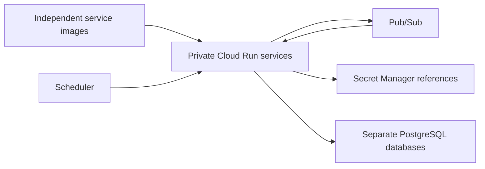

# Printer rental infrastructure - public reference

Terraform modules and mock tests for the printer rental microservices.
See the [system overview](https://github.com/Printerrenta/PSI-BE-public).



The public copy includes Terraform logic and mock tests. Real backend buckets,
environment files, deployment identities, operating release records and Cloud
Build deployment configuration are excluded. Mock project IDs and addresses are
examples. No runnable Java application belongs to this infrastructure repository.

From terraform/:

```sh
terraform fmt -check -recursive
terraform init -backend=false -lockfile=readonly
terraform validate
terraform test
```

Mock tests require no GCP credentials and create no cloud resources. Applying
infrastructure requires a separately configured backend, your own credentials,
review of IAM and costs, and an explicit operator decision. This public mirror
does not deploy the private environment.

PUBLIC_MIRROR.json records snapshot checksums. The public history is independent;
new snapshots follow successful main CI. Production configuration and private Git
history are never exported by the allowlist. Contributions belong in the source;
this generated mirror may replace direct edits on synchronization.
